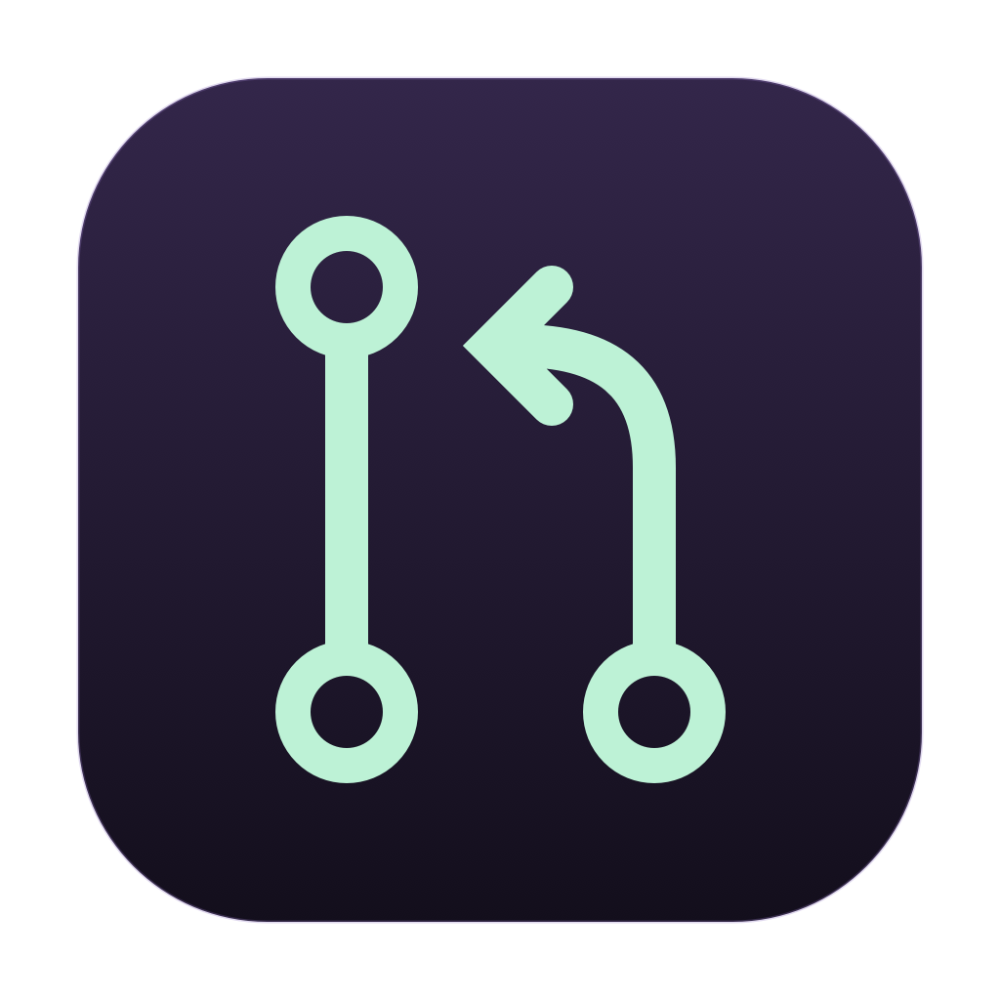
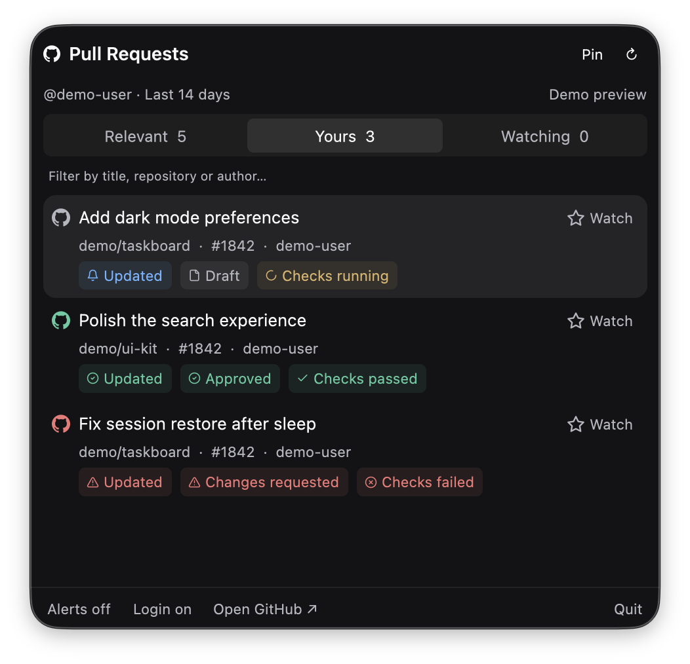

<div align="center">
  
  <h1>Quick PR</h1>
  <p><strong>Your pull requests. One glance away.</strong></p>
  <p>A compact macOS menu bar app for reviews, CI, and the PRs you care about.</p>

  <p>
    <a href="#install"></a>
    
    <a href="LICENSE"></a>
  </p>

  
  <p><sub>Fictional demo data.</sub></p>

  <p>
    <a href="#install">Install</a>
    &nbsp;·&nbsp;
    <a href="#how-it-works">How it works</a>
    &nbsp;·&nbsp;
    <a href="#shortcuts">Shortcuts</a>
    &nbsp;·&nbsp;
    <a href="#development">Development</a>
  </p>
</div>

---

## Why Quick PR

Reviews land. Checks finish. Someone asks for changes. Quick PR keeps that work within reach while you get on with everything else.

- **Know what changed.** The menu bar lights up when there’s something new since your last look. Open the panel to see exactly which PRs changed.
- **Focus on your work.** See your recent PRs, personal review requests, and anything you choose to watch. Team-wide review queues stay out of the way.
- **Read the status at a glance.** Separate review and CI badges make approvals, failures, drafts, and running checks easy to spot.
- **Keep it close.** Press **⌃⌥P**, filter the list, and jump straight to a PR. Pin the panel when you’re waiting on a build.
- **Use your existing login.** GitHub CLI handles authentication, including private repositories you already have access to.

Native Rust + GPUI, with Liquid Glass on supported macOS versions and a blurred fallback.

## Install

Currently built from source. You’ll need **macOS 12+**, [Rust](https://rustup.rs/) (current stable), and Xcode Command Line Tools.

Set up GitHub CLI if you haven’t already:

```sh
brew install gh
gh auth login
```

Then build and install:

```sh
git clone https://github.com/cesarferreira/quick-pr.git
cd quick-pr
make install
```

The app opens from `~/Applications/Quick PR.app`. Click its menu bar icon or press **Control–Option–P**. Open at login is enabled by default; toggle **Login on/off** in the panel.

## How it works

### A small signal when something changes

| Menu bar | What changed since your last look |
| --- | --- |
| 🔵 Blue dot | New activity on a tracked PR |
| 🔴 Red dot | Failing checks or changes requested |
| 🟢 Green dot | One of your PRs became approved with passing checks |
| No dot | You’re caught up |

The number beside the icon shows your **Relevant PR count** and stays visible when you’re caught up. It’s hidden when there are no relevant PRs. The colored dot shows unread activity separately.

Hover over the icon for a summary. Open the panel to clear the dot and find **New** and **Updated** badges beside the affected PRs. Hover those badges for the reason.

Red takes priority over green, then blue. The first sync is quiet, and unread activity survives app restarts.

### Three views of your work

| View | What’s inside |
| --- | --- |
| **Relevant** | Your PRs and personal review requests active in the last 14 days, plus open PRs you explicitly watch |
| **Yours** | Your recent open PRs, including drafts |
| **Watching** | PRs you’ve chosen to follow, even after they’re merged or closed |

Click **☆ Watch** on a row to follow a PR. Search by title, repository, author, or number. Click its title to open it in your browser.

Each row shows how long ago its review, CI, draft, or PR state last changed as observed by Quick PR. Hover the time for its exact UTC timestamp and source. Before a status change is observed, the time comes from GitHub activity or the first time Quick PR saw the PR. These times survive restarts.

## Shortcuts

| Shortcut | Action |
| --- | --- |
| **⌃⌥P** | Show / hide the panel |
| **Esc** | Dismiss |
| **⌘R** | Refresh |
| **⌘1 / ⌘2 / ⌘3** | Relevant / Yours / Watching |
| **↑ / ↓**, **Return** | Select and open a PR |
| **⌘⇧P** | Pin / unpin |

## Development

Use only fictional accounts, repositories, and task titles in demo fixtures and public screenshots.

```sh
cargo run                         # Run the app
cargo run -- --demo                # Preview with demo PRs and activity
cargo run -- --demo --background   # Preview the unread menu bar indicator
cargo run -- --check               # Check your live GitHub connection
make test                         # Run tests
make check                        # Formatting and Clippy
make package                      # Build dist/Quick PR.app
```

<details>
<summary><strong>GitHub access, refresh, and local data</strong></summary>

Quick PR uses the active **github.com** account in `gh`; GitHub Enterprise hosts are not supported yet. It does not copy or store your token. For private repositories, authorize any required organization SSO access in GitHub CLI.

It refreshes about once a minute while visible and every five minutes in the background. Requests are batched and results are cached; `gh` still consumes GitHub API quota. Errors trigger backoff, and a low rate-limit budget pauses automatic refresh. Press **⌘R** to refresh manually.

Each search shows up to 100 PRs, with a notice when more results exist. Explicit watches are limited to 100. “Recent” means GitHub activity in the last 14 days, including pushes and discussion. Cached results remain visible offline with their last update time.

Opening the panel marks the loaded changes as seen. Updates that arrive while it stays visible are highlighted immediately and considered seen. Switching GitHub accounts resets the activity baseline.

Preferences, PR snapshots, and last-viewed activity are stored in `~/Library/Application Support/Quick PR/`, restricted to your user. Delete that directory to reset the app.

</details>

<details>
<summary><strong>Notifications and macOS setup</strong></summary>

System notifications are off by default. Toggle **Alerts on/off** for review requests, failing CI, new discussion, and approval with passing checks. Notifications currently use AppleScript, so delivery and sender identity depend on macOS notification settings. Passing checks and approval do not guarantee a PR meets every merge rule.

Open at login requires macOS 13+ and the installed app. If approval is needed, enable Quick PR in **System Settings → General → Login Items**. If **⌃⌥P** is already in use, the menu bar still works and the panel shows a shortcut warning.

Local builds are ad-hoc signed. Distribution notarization is not configured.

</details>

## Releasing

Release from a clean `main` checkout on macOS, with GitHub CLI authenticated and
crates.io credentials configured using `cargo login`.

```sh
make release-dry-run LEVEL=patch  # Checks and preview; no upload, tag, or push
make release LEVEL=patch          # Publish, commit version/changelog, tag, push
```

Like stax, `LEVEL` defaults to `minor`; use `LEVEL=release` to publish the current
version unchanged (including the first `0.1.0` release), or pass an explicit version.
The Make targets install `cargo-release` and `git-cliff` if needed. Both modes run
tests, formatting checks, and Clippy first. The actual release requires a public
repository; it never changes repository visibility.

`cargo-release` updates the version and `CHANGELOG.md`, commits those changes,
publishes to crates.io locally, then tags and pushes `v<version>`. That tag triggers GitHub Actions to build Apple Silicon and
Intel `.app` ZIPs and attach them, with SHA-256 checksums, to a GitHub release.
The apps are ad-hoc signed, without notarization. If packaging fails after the
crate is published, fix the workflow and rerun it on the same tag; crates.io
versions cannot be overwritten.

After publication, `cargo install quick-pr --locked` will install the macOS
executable. It does not install an app bundle; use the GitHub release ZIP for the
`.app`, or `make install` when building from source. GitHub CLI is required for
all install methods.

## License

[MIT](LICENSE)
